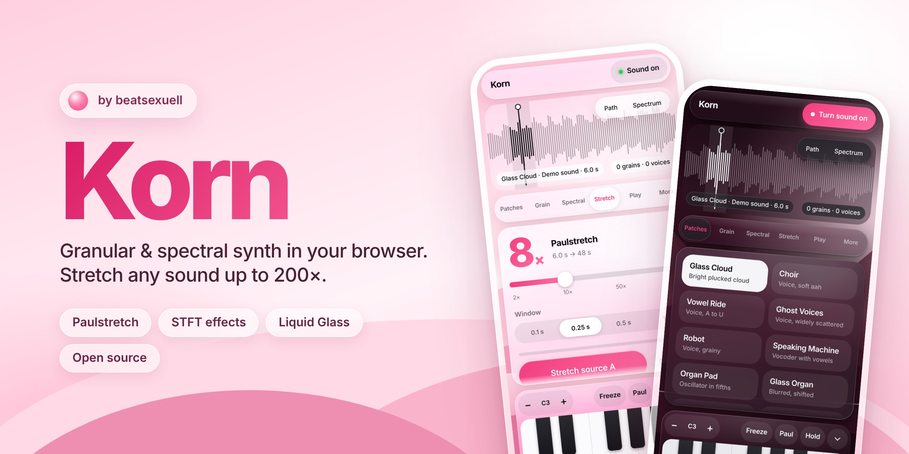
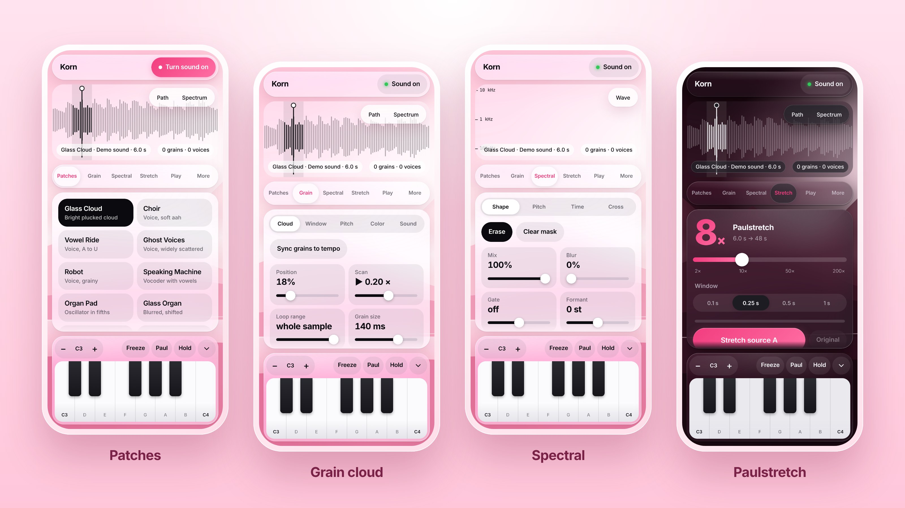
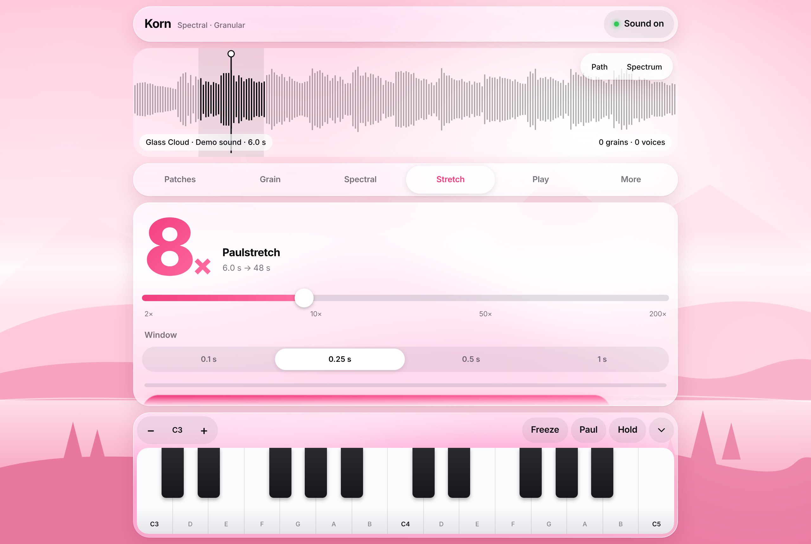

<div align="center">

<a href="https://beatsex.github.io/korn/"></a>

<h3>Granular & spectral synth in your browser. Stretch any sound up to 200×.</h3>

<p>
<a href="https://beatsex.github.io/korn/"></a>
</p>

<p>
<a href="LICENSE"></a>


<a href="https://github.com/Beatsex/korn/stargazers"></a>
</p>

<sub>Made by <a href="https://github.com/Beatsex">beatsexuell</a> · free & open source</sub>

</div>

---

## ✦ What it is

**Korn** turns any sound (your voice, a sample, a loop) into clouds, drones and textures. It is a
granular sampler, a spectral processor and an extreme time-stretcher in one page that runs in
any modern browser, on phone and desktop. No install, no account, nothing leaves your device.

<p align="center"></p>

## ✦ Features

<table>
<tr>
<td width="50%" valign="top">

### 🌫️ Granular cloud
- 4 scan heads with position, scan, loop range, spray
- Grain size, density, window shapes, reverse, filter per grain
- Pitch, octave, glide, drift, stereo spread
- Sync grains to tempo

</td>
<td width="50%" valign="top">

### 🌈 Spectral engine
- STFT, 2048-point FFT with 4× overlap in an AudioWorklet
- Freeze, blur, shift, stretch, gate, scramble, spectral delay
- Formant, tonal/noise, tilt, harmonic sieve, sustain, diffuse
- Tune to scale, harmonizer, morph and vocoder with a second source
- Paint the spectrum with your finger

</td>
</tr>
<tr>
<td valign="top">

### ⏳ Paulstretch
- 2× to 200× extreme time-stretch with a log slider
- Window 0.1 s (sharper) to 1 s (pure surface)
- Renders in the background with progress, one tap back to the original
- **Paul freeze:** an endless random-phase drone, live

</td>
<td valign="top">

### 🎹 Play & shape
- Multitouch keyboard, XY pad, macros, tilt control
- 2 LFOs, 16-step sequencer, arpeggiator, scales and chords
- DJ filter, reverb, ping-pong delay, compressor
- 30 patches, morph between patches, share patches as code

</td>
</tr>
<tr>
<td valign="top">

### 🎙️ Sources
- Load WAV, MP3, M4A, AIFF, FLAC, OGG (up to 90 s)
- Record from the mic or resample the output
- Built-in voice, oscillator and demo sounds

</td>
<td valign="top">

### 💾 Export
- Record what you play as WAV
- Bar-exact loops at the sequencer tempo
- Liquid Glass UI in pink and white, light and dark mode

</td>
</tr>
</table>

<p align="center"></p>

## ✦ Quick start

**Just play:** open **[beatsex.github.io/korn](https://beatsex.github.io/korn/)**, tap *Turn sound on*, play the keys.

**First Paulstretch in 10 seconds:**
1. *More › Source* → load a vocal or a chord
2. *Stretch* → set 16×, window 0.5 s → **Stretch source A**
3. Play the keys. For an endless drone, tap **Paul**.

**Run locally:**
```bash
git clone https://github.com/Beatsex/korn.git
cd korn && npx serve .
```
Or simply open `index.html` in your browser.

## ✦ How it works

```
 Source A ─┬─► Grain engine (4 heads, Web Audio buffers) ─┬─► direct ─────────┐
           │                                               └─► Spectral STFT ─┤
 Source B ─┴──────────────────────────────────────────────────► (morph/voc)   │
                                                                              ▼
                               DJ filter ► Reverb ► Ping-pong delay ► Compressor ► Out
 Paulstretch: offline, random-phase STFT  ─►  replaces Source A
```

- **Spectral engine:** a self-contained STFT class that runs inside an `AudioWorklet`, with a `ScriptProcessor` fallback.
- **Paulstretch:** an independent implementation of Nasca Octavian Paul's technique: window `(1−x²)^1.25`, one set of random phases for all channels (keeps the stereo image), RMS-matched output, rendered in chunks so the UI never blocks.
- Everything lives in one `index.html`, with no dependencies and no build step.

## ✦ Contributing

Bugs, ideas and pull requests are welcome. Read [CONTRIBUTING.md](CONTRIBUTING.md) and the
[Code of Conduct](CODE_OF_CONDUCT.md), then open an [issue](https://github.com/Beatsex/korn/issues).

## ✦ License & credits

MIT © 2026 Victor Jörissen ([beatsexuell](https://github.com/Beatsex)). See [LICENSE](LICENSE).

The time-stretch is inspired by **Paulstretch** (Nasca Octavian Paul) and **PaulXStretch**
(Xenakios, Jesse Chappell). Korn contains none of their code. Details are in
[THIRD_PARTY_NOTICES.md](THIRD_PARTY_NOTICES.md).

<div align="center"><sub>If Korn made a sound you love, leave a ⭐</sub></div>
